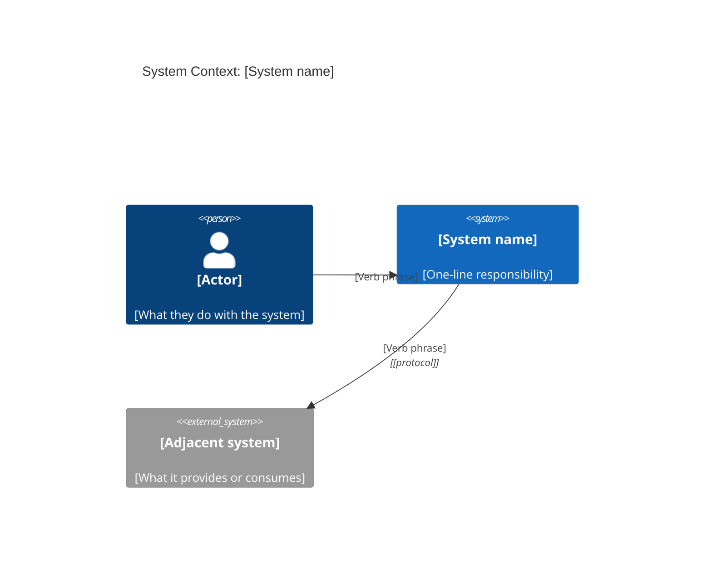
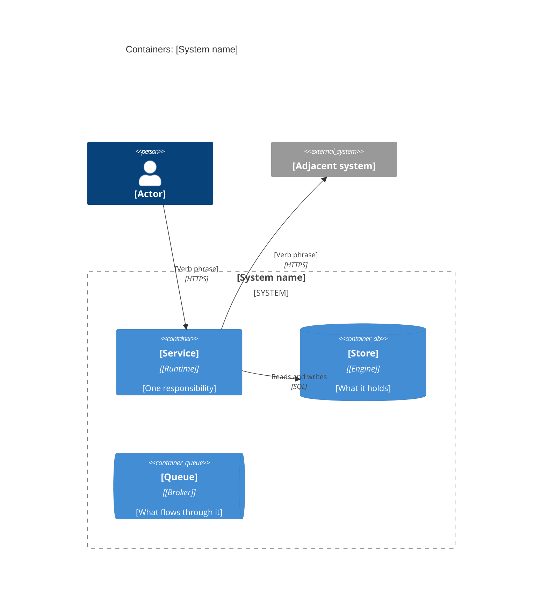
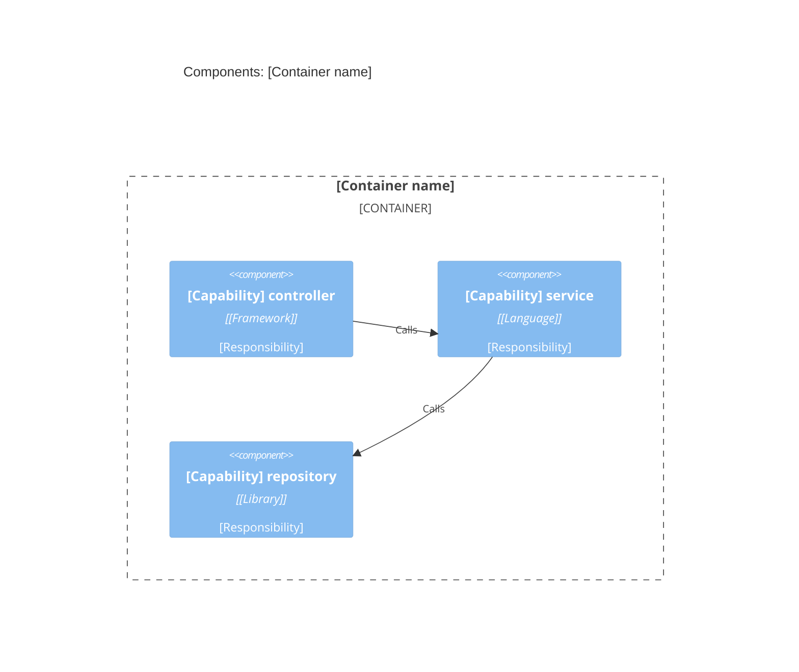

# Architecture Views Template (C4)

**Authors:** Haresh V. Parekh

---

Copy the blocks below into `docs/architecture/` in the project. The views are living documents: they
describe the system as it is now, and they change in the same PR as the code they describe. A
decision about why the system looks this way goes in an ADR (`adr-template.md`), which links to the
view; the view never carries the decision's reasoning.

Diagrams are written as Mermaid C4 blocks so they render in the repository host and diff in review.
A project that already standardizes on another text format (PlantUML, Structurizr DSL) may keep it,
declared in CLAUDE.md. A diagram that exists only as an exported image is not acceptable: nobody can
review a change to it.

## Folder

```
docs/architecture/
  context.md                 C4 Level 1: the system, its actors, adjacent systems
  containers.md              C4 Level 2: services, data stores, queues, execution environments
  components-<container>.md  C4 Level 3: one file per container whose internals need it
```

Level 4 (code) is not drawn. The source tree, laid out per `micro/project-structure.md`, is that level.

## Header for every file

````markdown
Status: Current
Last Reviewed: YYYY-MM-DD
Owner: [team or individual]
Decisions: ADR-NNN, ADR-NNN
Specs: .specs/<feature-slug> (features that changed this view)
````

`Decisions` lists the ADRs that shaped what is drawn. `Specs` lists the features whose `design.md`
added or changed an element. Both let a reader find the reasoning without it living in the diagram.

## context.md

````markdown
# System Context: [System name, in Terminology Lock terms]

[Two sentences: what the system does and for whom.]



## Actors and adjacent systems
| Name | Kind | Interaction | Owner |
|---|---|---|---|
| [name] | Person / External system | [what crosses the boundary] | [team or vendor] |
````

## containers.md

````markdown
# Containers: [System name]



## Container inventory
| Container | Responsibility | Owns data | Contract | Trust boundary |
|---|---|---|---|---|
| [name] | [one responsibility] | [yes / no, which] | [link to API or event contract] | [inside / edge / external] |
````

The trust-boundary column is what `eng-os-security-practices` reads when it draws a threat model.
The contract column links to `docs/contracts/` or the OpenAPI file rather than restating it.

## components-[container].md

Add this file only when the container's internals materially affect correctness, scale, or
reviewability (the rule in `meso/system-design.md`).

````markdown
# Components: [Container name]


````

## When a view must change

A PR that does any of the following updates the matching view in the same PR:

| Change | View |
|---|---|
| New or removed external actor or adjacent system | `context.md` |
| New, removed, split, or merged service, data store, queue, or scheduled job | `containers.md` |
| New or changed trust boundary, or a new owner for a container | `containers.md` |
| A container's internal responsibilities reorganized | `components-<container>.md` |

A change to code inside an existing component, with no new boundary or dependency, does not touch the views.
